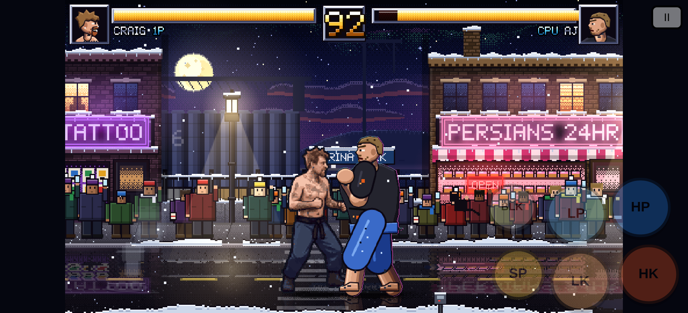

# Thunder Bay Brawl

A mobile-first 2D street fighter in the style of SF2 and MK3, set on Bay Street in Thunder Bay at 2 AM. The whole game is one file, `index.html`, built with Canvas 2D and plain JavaScript. There is no build step and nothing to install to play solo.

**Play:** https://mono667.github.io/thunder-bay-brawl/ (1P vs CPU works anywhere. Online 2P needs the server described below.)



## What's in it
- **Fighters** (procedural pixel art, generated at load: 2–3 tone cel shading, dark outlines, and multi-frame animations for idle, walk, jump, crouch, every attack with anticipation/active/recovery frames, block, hit, knockdown, get-up, win and specials). All five are stylized likenesses drawn in code, never photos. Fighters have squash and stretch on landings and hits, secondary motion on hair, chains and straps, a rim light from the street lamps, and soft ground shadows:
  - **CRAIG** is a scrappy all-round brawler with 1000 HP. Special: **INK SPLASH**, a thrown blob of tattoo ink.
  - **AJ** is the big man: the largest sprite, 1200 HP, the slowest walk and the heaviest hits with big knockback. His heavy attacks have armor against light hits, and he is hard to juggle. Specials: **BACKYARD SLAM** (SP), an unblockable grab and over-the-shoulder slam, and **PATIO QUAKE** (SP + down), a ground stomp that hits grounded opponents across a wide range.
  - **BINO** is a shirtless, mid-speed rushdown fighter with 1000 HP, fast slashing chains and strong close pressure. Specials: **CHAIN SPARK** (SP), a thrown chain projectile, and **BEARD FURY** (SP + down), a forward-drifting multi-hit chain flurry. Taunt grab: **KISS MY BUTT** (SP + up), a short-range command grab. He shouts "ALL GOD DAMN DAY!", the opponent is pulled behind him and a SMOOCH! burst covers the moment. The opponent is left dizzy, and Bino gets an 8-second aura worth +20% damage. It has a 15-second cooldown, and a whiff leaves him open to a COUNTER hit.
  - **SARA** is the fastest fighter, with 900 HP, a dash (tap forward twice) and quick chains. Specials: **WIRE TOSS** (projectile) and **DROP IN** (SP + down, or down, down-forward, forward + kick), a teleport drop kick. Her face has bright, open eyes behind thin clear frames, a big toothy grin on the select and win portraits, and a focused look in the fight.
  - **DIRTY** is a lanky zoner with 900 HP, stretchy long-reach limbs, a floaty jump and the slowest walk. He wears a backwards white flat-brim cap, shades, a blue tee and a backpack, carries a boombox, and rides off on a BMX when he wins. His catchphrase is "Nice nice nice nice nice!". Specials:
    - **NICE NICE NICE** (SP): a slow boombox sound wave.
    - **VANISHING TRICK** (SP + down): a teleport behind the opponent. Hold back to land in front instead.
    - **FIVE-FINGER DISCOUNT** (SP + forward): a grab that steals the opponent's cap, glasses or top for about 6 seconds and gives him a buff. The victim stays covered (bare head, or a white undershirt), and the item flies back when time is up.
- **VS showdown:** the two portraits slide in nose to nose with lightning and a screen shake. Then P1 taunts and P2 replies, with matchup banter for every pair. It lasts about 3–4 s; tap or press any button to skip. Online, the host picks the line and both phones show it.
- **Match flow:** best of 3 rounds with a 99-second timer. Pixel-font banners show ROUND 1, FIGHT!, K.O. (with a white flash), TIME and the winner. The match end shows the winner's portrait and taunt.
- **Combat:**
  - Chrome health bars with portraits (they change to a hurt face when hit) and a delayed red drain.
  - Hitboxes and hurtboxes, hitstun and blockstun.
  - Chip damage on blocked hits, plus knockback and wall pushback.
  - Fighters turn to face each other automatically.
  - Jump and crouch attacks (crouching LK is a low sweep).
  - Big hit, heavy-hit and block sparks, hitstop, landing dust, a white hit flash, afterimages on dashes and specials, screen shake and sound effects.
  - A super-freeze with a darkened background and the move name on every special, an "N HITS!" combo counter, COUNTER callouts, and a slow-motion zoom on the K.O.
- **Modes:** a CPU opponent (picked at random from the other four; `?cpu=dirty` forces one), a 5-slot character select with stat bars, a pause menu, and online 2P with room codes.
- **Stage:** Bay Street, Port Arthur at 2 AM with parallax layers: the sky with stars, moon and a faint aurora; Lake Superior and the Sleeping Giant; the grain elevators, harbour cranes and skyline; and brick storefronts. It also has flickering neon (one sign is on the fritz), lamp glow, an animated crowd that cheers on a K.O., steam from the vents, passing headlights, snow gusts, two layers of snow, a foreground parallax layer, and wet-road reflections of the shops, neon and fighters.
- **Stage 2, MAY STREET ALLEY BAR (Fort William):** the back alley behind a dive bar off May Street at night. It has a brick wall, a lit back door under a flickering caged bulb, a generic neon sign reading 'THE MAY ST. TAVERN', dumpsters, stacked kegs and crates, a fire escape, a chain-link fence, garbage bags, puddles and slush with reflections, snow, and an alley cat on the dumpster. Patrons by the door cheer on a K.O. A May St sign marks the alley mouth, where car lights pass by, and grain elevators show faintly in the distance. It uses the same parallax, FX and auto-quality as Bay Street.
- **Stage select:** comes after character select. Tap BAY STREET, MAY STREET ALLEY BAR or RANDOM; the thumbnails are live renders of each stage. CPU matches use your pick. Online matches use the host's pick, which is synced to the guest. Use `?stage=alley` to preselect a stage.
- **Title:** an attract mode where the camera pans down Bay Street while fighters idle and pose, under an animated pixel logo. Each round opens with a zoom-in.
- **Options:** a CRT scanline toggle on the title screen (remembered; `?crt` turns it on).
- **Performance:** everything is pre-rendered into offscreen canvases once at load (about 0.5 s). If the frame rate drops below 50, the game steps quality down from 2 to 1 to 0 (reflections and glow go first, then crowd animation and snow). `?q=0|1|2` locks the level.

## Controls
| | Touch (landscape) | Keyboard |
|---|---|---|
| Move / jump / crouch | Floating stick: put your thumb anywhere on the left half (up = jump, down = crouch, with generous diagonals) | Arrows or WASD |
| Light / heavy punch | LP / HP | J / K |
| Light / heavy kick | LK / HK | U / I |
| Block | BLK, or hold **back** | L, or hold back |
| Special | SP, or LP+HP together, or ↓ ↘ → + punch | O, or ↓ ↘ → + J/K |
| Special 2 (AJ, BINO, SARA, DIRTY) | SP + down, or ↓ ↘ → + kick | O + ↓, or ↓ ↘ → + U/I |
| Special 3: FIVE-FINGER DISCOUNT (DIRTY) | SP + forward | O + → |
| Taunt grab: KISS MY BUTT (BINO) | SP + up | O + ↑ |
| Pause | ❚❚ button (top-right corner) | P / Esc |

On touch screens the buttons are large and sit in an arc on the right. They are see-through at rest and light up when pressed. Nothing covers the health bars, and you can hold the stick and press buttons at the same time.

Add `?boxes` to the URL to see hitboxes (red) and hurtboxes (green).

## Running it
- **Solo, quickest:** open the GitHub Pages link on a phone and turn it sideways. You can also open `index.html` straight from disk.
- **Static server on a computer:** `python3 -m http.server 8000` in this folder, then open `http://<computer-ip>:8000`. This works for solo only.
- **Online 2P:** run the Node server below. It serves the game and also relays matches between phones.

## Online 2P server on the Windows laptop
Use the always-on laptop as the server.

1. **Install Node.js LTS.** Get it from https://nodejs.org, or in PowerShell run `winget install OpenJS.NodeJS.LTS`.
2. **Get the game.** Either `git clone https://github.com/Mono667/thunder-bay-brawl.git`, or on GitHub click **Code → Download ZIP** and unzip it.
3. **Start the server.** Double-click **`start-server.bat`** in the game folder. It installs the server packages on first run, starts the server, and keeps the window open. You can also open a terminal in the `server` folder and run `npm install` once, then `node server.js`.
   - The server listens on **port 8080**. To change it, run `set PORT=9000` before `node server.js` in cmd, or `$env:PORT=9000` in PowerShell.
   - On startup the window prints `Phones open: http://192.168.x.x:8080` for each network adapter. Use the Wi-Fi one.
4. **Firewall.**
   - When Windows asks about Node.js, tick **Private networks** and click Allow.
   - Or, in an **admin** PowerShell, run:
     ```
     New-NetFirewallRule -DisplayName "Fighter 8080" -Direction Inbound -Protocol TCP -LocalPort 8080 -Action Allow -Profile Private
     ```
   - The Wi-Fi network must be set to **Private**: Settings → Network & internet → Wi-Fi → your network → Network profile type: Private.
5. **Find the laptop's IP.** Run `ipconfig` and use the **IPv4 Address** under "Wireless LAN adapter Wi-Fi". The server also prints it.
6. **Keep it awake.** Go to Settings → System → Power → Screen and sleep, and set "When plugged in, put my device to sleep after" to **Never**.
   - Optional: add a DHCP reservation for the laptop in your router so its IP never changes.
7. **Play from the phones.**
   - Both phones must be on the same Wi-Fi as the laptop.
   - Open `http://<laptop-ip>:8080` and tap **ONLINE 2P**. Each player picks a fighter and taps **FIGHT!**.
   - Phone 1 taps **CREATE ROOM** and gets a 4-letter code.
   - Phone 2 types the code and taps **JOIN ROOM**.
   - The creator plays P1 and their phone runs the fight.
   - The server field fills itself in when the page comes from the laptop.
8. **Internet play (optional).** Pick one:
   - Port-forward TCP 8080 on the router to the laptop's IP.
   - Or install cloudflared and run `cloudflared tunnel --url http://localhost:8080`, then share the `https://….trycloudflare.com` URL. Secure WebSockets (wss) are used automatically over https.

On the GitHub Pages copy, online play won't reach a LAN server, because browsers block an https page from opening an insecure ws:// connection. Open the game from the laptop URL, or use a cloudflared tunnel.

Check that it's up: `http://<laptop-ip>:8080/health` returns `ok`.

**Linux or macOS:** run `cd server && npm install && PORT=8080 node server.js`. The code uses only cross-platform Node.

## Changing a look, or swapping in real art
**Restyling a procedural fighter:** each fighter is one data block in `ART` at the top of `src/3b.js`. It has body dimensions (`D`), 4-tone palettes (`M`) and wardrobe/feature flags (`L`: top, lower, feet, hair, beard, hat, glasses, ink zones, rings, chain, can…). Change a colour or flag there and run `node build.js`. Every frame and portrait is regenerated from it.

**Sprite sheet:** to switch a character to a hand-drawn PNG sheet, set this on its `CHARS` entry in `src/2.js`:
```js
render: 'sprite',
sprite: { src: 'art/sara.png', fw: 180, fh: 128, ox: 86, oy: 116, scale: 1,
  anims: { idle:{row:0,n:4,fps:8}, walk:{row:1,n:6,by:'walk',div:3}, crouch:{row:2,n:1}, jump:{row:3,n:3,by:'vy'},
           lp:{row:4,n:3,ph:['s','a','r']}, hp:{row:5,n:4,ph:['s','a','a','r']}, lk:{row:6,n:3,ph:['s','a','r']}, hk:{row:7,n:4,ph:['s','s','a','r']},
           clp:{row:8,n:3,ph:['s','a','r']}, chk:{row:9,n:3,ph:['s','a','r']}, jp:{row:10,n:2,ph:['s','a']}, jk:{row:11,n:2,ph:['s','a']},
           block:{row:12,n:1}, cblock:{row:13,n:1}, hit:{row:14,n:2}, kd:{row:15,n:3}, lie:{row:16,n:1}, rise:{row:17,n:3},
           win:{row:18,n:4,fps:6}, sp:{row:19,n:4,ph:['s','s','a','r']} /* sp2, dsh, land, ko, chit, clk, chp also accepted */ } }
```
- **Frame layout:** each row is one animation and each frame is `fw`×`fh` pixels.
- **Anchor:** `ox`/`oy` is the point between the fighter's feet.
- **Facing:** draw facing **right**; the game mirrors it.
- **Phases:** `ph` maps each frame to startup (`s`), active (`a`) or recovery (`r`) so the art stays in sync with the hitboxes.
- **Fallbacks:** crouching moves fall back to the standing anim, and any missing anim uses `idle`.
- **Loading:** the procedural art is drawn until the image finishes loading (preloaded at boot). If the PNG fails to load, the fighter stays on the procedural art for the session; it also switches back to it while a stolen-item look is worn.
- **CRAIG** uses one: `art/craig.png` (AI-generated stylized frames, cleaned up into a 20-colour sheet). Hitboxes, stats and netcode are unchanged.

Hitboxes are defined per move and are independent of the art. Use stylized likenesses only, not photos. After editing `src/`, run `node build.js` to rebuild `index.html`.

## Files
- `index.html`: the game, built from `src/1.html`, `src/2.js` (data and simulation), `src/3a.js` (canvas, palette quantizer, pixel font), `src/3b.js` (procedural fighter art, portraits, renderers), `src/3c.js` (May Street Alley Bar stage art), `src/3d.js` (stage, FX, HUD, banners, CRT, auto quality, sound) and `src/4.js` (UI, input, online, loop).
- `server/`: the Node HTTP and WebSocket server (needs the `ws` package). `start-server.bat` launches it on Windows.
- `test/test.js`: a headless Playwright test on a landscape iPhone 13 with touch.
  - Run it with: `cd test && npm install && npx playwright install chromium`, then start the server with `PORT=8090 node ../server/server.js` and run `node test.js`.
